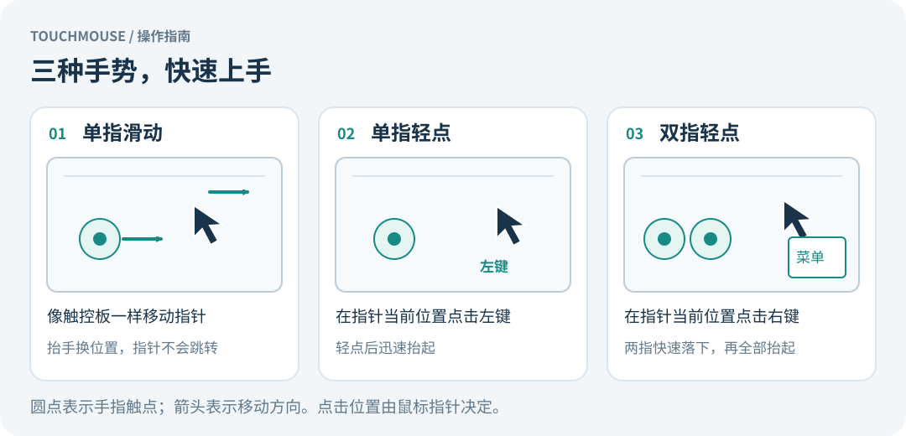

# Touchmouse 安装与使用

本文面向 Raspberry Pi OS / Debian、Wayland + labwc 桌面。请先获取源码，在项目根目录执行以下命令；`./control` 均指仓库中的控制脚本。

## 环境与编译

需要支持 evdev、uinput 的 Linux，以及名称包含 `Goodix Capacitive TouchScreen`、支持 MT slot 协议的触摸屏。其他设备需修改 `src/main.rs` 中的 `device()` 并自行验证。程序只选择第一个匹配设备。

```sh
sudo apt update
sudo apt install rustc cargo build-essential bash acl pkexec util-linux
rustc --version
cargo --version
cargo test --locked
cargo build --release --locked
```

需要 Rust 1.74 或更新版本；发行版工具链较旧时先升级。首次构建需要下载依赖，缓存齐全后可添加 `--offline`。输出为 `target/release/touchmouse`。

## 输入设备权限

程序应由已登录图形桌面的普通用户运行，并保留 `XDG_RUNTIME_DIR`，不要使用 `sudo ./control start`。

### uinput 权限

推荐执行一次：

```sh
sudo bash install-permissions.sh "$(id -un)"
```

脚本创建 `/etc/udev/rules.d/99-touchmouse-uinput.rules`，将 `/dev/uinput` 所有者设为指定用户，权限设为 `0600`；创建 `/etc/modules-load.d/touchmouse.conf` 以在开机加载 uinput，并立即加载模块、重载规则和验证所有者。不同内容的已有配置不会被覆盖。

该权限允许用户创建虚拟输入设备；当前脚本面向单个桌面用户。它不会授权读取触摸屏。

未安装持久规则时，控制脚本会尝试通过 `pkexec setfacl` 临时授权，需要桌面 Polkit 认证代理。临时权限通常在重启或设备重建后失效。如果 `/dev/uinput` 不存在，先执行：

```sh
sudo modprobe uinput
```

### 触摸事件读取权限

如果日志提示 `/dev/input/event*` 无读取权限，先检查设备节点及当前用户组：

```sh
ls -l /dev/input/event*
id
```

若系统提供 `input` 组，可由管理员将当前用户加入，然后注销并重新登录：

```sh
sudo usermod -aG input "$(id -un)"
```

`input` 组可能允许读取其他输入设备，仅向需要此权限的用户授予。

## 先从终端试用




```sh
./control start
pgrep -a -x touchmouse
tail -n 40 "$XDG_RUNTIME_DIR/touchmouse.log"
```

`start` 在后台启动，返回终端不代表启动成功。抬起所有手指后，测试单指滑动、单指左键轻点和双指右键轻点。

```sh
./control stop
./control toggle
```

停止后恢复原生触摸。尚未运行时，停止命令可能提示套接字不存在。手势限制见 [README](README.md#功能与限制)。

## 安装到系统

编译完成后执行：

```sh
sudo bash install-system.sh "$(id -un)"
```

脚本安装到 `/usr/local/lib/touchmouse/`，创建命令入口 `/usr/local/bin/touchmouse`，并调用权限脚本。它不会修改桌面快捷键，也不会自动启动程序。若命令入口已有其他文件，脚本会拒绝覆盖。

```sh
/usr/local/bin/touchmouse start
/usr/local/bin/touchmouse stop
/usr/local/bin/touchmouse toggle
```

系统安装后运行不依赖源码目录。以下快捷键示例均使用系统安装路径。

## 绑定 F9（labwc）

如果 `~/.config/labwc/rc.xml` 已存在，先备份；不要覆盖以前保留的备份：

```sh
cp -i ~/.config/labwc/rc.xml ~/.config/labwc/rc.xml.before-touchmouse
```

如果没有用户配置，可先复制系统模板：

```sh
mkdir -p ~/.config/labwc
cp -i /etc/xdg/labwc/rc.xml ~/.config/labwc/rc.xml
```

在现有 `<keyboard>` 节点内添加：

```xml
<keybind key="F9">
  <action name="Execute" command="/usr/local/lib/touchmouse/control toggle" />
</keybind>
```

保留原有快捷键，不要创建第二个 `<keyboard>`。若用户配置没有该节点，先从系统模板复制完整的 `<keyboard>...</keyboard>` 至用户配置的 `<openbox_config>` 内，再添加绑定。已有 F9 绑定时先解决冲突。

```sh
labwc --reconfigure
```

F9 按一次开启、再按一次停止；它会占用应用中的 F9 功能，部分键盘需要 Fn。其他桌面请通过其快捷键设置绑定同一命令。仅从源码运行时，将 XML 中的命令路径替换为项目内 `control` 的实际绝对路径。

## 调整速度

允许范围为大于 0 且不超过 10，默认为 1.0。更改前先停止：

```sh
/usr/local/bin/touchmouse stop
TOUCHMOUSE_SPEED=0.7 /usr/local/bin/touchmouse start
```

环境变量仅影响本次启动。要让 F9 固定使用 0.7，将绑定中的 action 改为：

```xml
<action name="Execute" command="/usr/bin/env TOUCHMOUSE_SPEED=0.7 /usr/local/lib/touchmouse/control toggle" />
```

修改后运行 `labwc --reconfigure`。

## 更新

在源码目录测试、编译并重新安装：

```sh
cargo test --locked
cargo build --release --locked
/usr/local/bin/touchmouse stop
sudo bash install-system.sh "$(id -un)"
/usr/local/bin/touchmouse start
```

仅从源码运行时，用 `./control stop` 和 `./control start` 停启，不需要系统安装步骤。重新编译不会自动升级已运行的进程。

## 故障排查

- **F9 无反应**：从桌面终端启动，查看日志；检查绑定路径、F9 冲突，并执行 `labwc --reconfigure`。
- **`XDG_RUNTIME_DIR` 缺失**：在当前桌面用户的图形终端启动；不要通过 sudo 或缺少桌面环境变量的远程会话启动。
- **`Permission denied`**：根据日志中的路径区分 uinput 和触摸屏权限，参见 [输入设备权限](#输入设备权限)。
- **认证窗口不出现**：确认桌面有 Polkit 认证代理，或使用持久授权脚本。临时授权也可执行 `sudo setfacl -m "u:$(id -un):rw" /dev/uinput`。
- **找不到 Goodix 设备**：检查 `/proc/bus/input/devices`。设备编号变化不影响发现，名称不同需修改 `device()`。
- **双指没有右键**：双指快速落下并全部抬起，避免滑动、长按和第三指；确认使用新编译的版本并已重启进程。
- **旋转后方向不对**：程序未应用桌面旋转和校准矩阵，需在代码中交换或反转 X/Y 并重新编译。
- **设备断连或事件溢出**：程序会退出；排除问题后重新启动。

触摸被占用时先运行停止命令，紧急恢复：

```sh
pkill -TERM -x touchmouse
```

进程退出后内核会释放设备独占。

## 卸载与恢复

1. 停止程序：系统安装使用 `/usr/local/bin/touchmouse stop`，源码运行使用 `./control stop`。
2. 移除 F9 绑定并执行 `labwc --reconfigure`。也可恢复自己的备份，但会覆盖备份后的其他配置更改。
3. 系统安装时，删除本项目安装的 `/usr/local/bin/touchmouse` 符号链接及 `/usr/local/lib/touchmouse/` 目录。
4. 如果配置过持久权限，删除本项目创建的 `/etc/udev/rules.d/99-touchmouse-uinput.rules` 和不再需要的 `/etc/modules-load.d/touchmouse.conf`，执行 `sudo udevadm control --reload-rules` 并重启，恢复设备默认权限。
5. 如果用过临时 ACL，在停止程序后运行 `sudo setfacl -x "u:$(id -un)" /dev/uinput` 撤销对应用户条目；该操作仅适用于条目存在且确由本工具添加的情况。
6. 若为本项目新加入过 input 组，且没有其他工具依赖该权限，可用 `sudo gpasswd -d "$(id -un)" input` 移除并重新登录。

停止并清理快捷键后，可按需删除源码目录。
