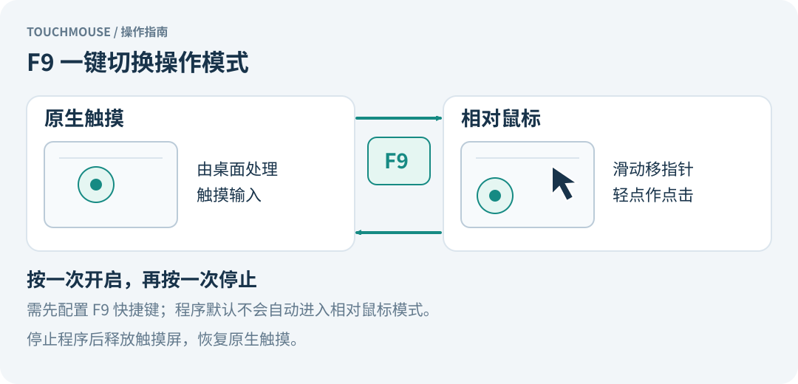
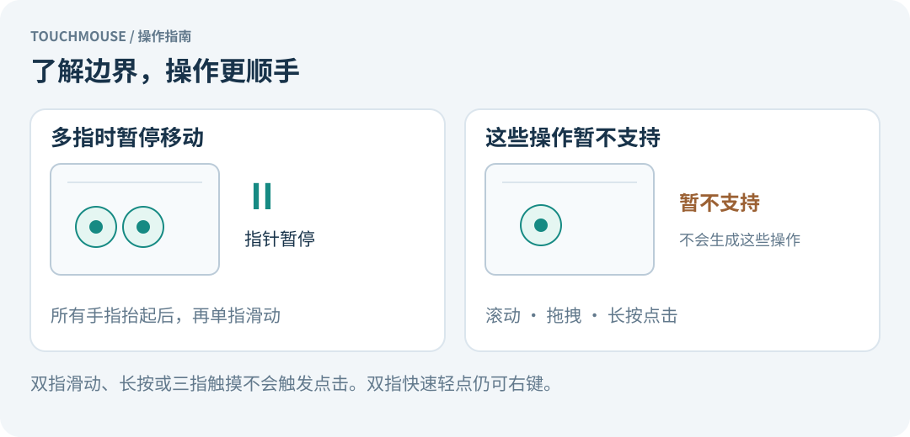

# Touchmouse

将 Goodix 触摸屏变成相对定位的鼠标：滑动移动指针，单指轻点左键，双指轻点右键。使用 Rust 编写，通过 Linux evdev 读取触摸事件、uinput 创建虚拟鼠标。

适合希望像使用触控板一样操作触摸屏的 Linux 桌面用户。当前面向 Raspberry Pi OS / Debian 的 Wayland + labwc 环境；其他桌面和硬件需要自行验证。

> 本项目以 **PolyForm Noncommercial License 1.0.0** 提供源码，仅授权协议允许的非商业用途。商业用途需另行取得权利人的授权。详见 [许可证](#许可证)。

## 手势图解


手指控制的是鼠标的相对位移；点击发生在**当前指针位置**。抬手后换一个位置继续滑动，指针不会跳到手指落点。





## 功能与限制

| 操作 | 行为 |
| --- | --- |
| 单指滑动 | 相对移动鼠标指针，抬手后重新落点不会跳转 |
| 单指轻点 | 在当前指针位置点击左键 |
| 双指轻点 | 在当前指针位置点击右键 |
| 双指及更多手指触摸 | 暂停指针移动，全部抬起后恢复 |
| 停止程序 | 释放触摸屏，恢复原生触摸 |

- 可绑定 F9 在相对鼠标模式与原生触摸之间切换；快捷键需手动配置。
- 支持调整移动速度，默认不自动启动相对鼠标模式。
- 暂不支持滚动、拖拽和长按点击。双指滑动、三指触摸不触发点击。
- 自动查找名称包含 `Goodix Capacitive TouchScreen` 的第一个设备，不依赖固定的 `event` 编号。其他设备需修改 [src/main.rs](src/main.rs) 中的 `device()`。
- 直接使用原始坐标位移，不会自动应用桌面的屏幕旋转或触摸校准矩阵。

## 快速开始

以下命令在项目根目录、已登录的图形桌面终端中执行。需要 Linux evdev/uinput、支持 MT slot 协议的触摸屏，以及 Rust 1.74 或更新版本。

### 1. 安装依赖并编译

Debian / Raspberry Pi OS：

```sh
sudo apt update
sudo apt install rustc cargo build-essential bash acl pkexec util-linux
rustc --version
cargo --version

cargo test --locked
cargo build --release --locked
```

如果发行版提供的 Rust 低于 1.74，请先升级工具链。首次编译需联网获取锁定的依赖；已缓存依赖时可添加 `--offline`。生成的程序位于 `target/release/touchmouse`。

### 2. 配置权限并试用

为当前桌面用户配置持久 uinput 权限（需要一次管理员授权）：

```sh
sudo bash install-permissions.sh "$(id -un)"
./control start
```

程序以普通用户运行，不要使用 `sudo ./control start`。授权脚本设置 uinput 模块开机加载，并将 `/dev/uinput` 的所有者设为指定用户、权限设为 `0600`；它不会修改触摸屏权限。

如果日志提示触摸屏 `/dev/input/event*` 无读取权限，按 [安装文档](INSTALL.md#输入设备权限) 配置后注销并重新登录。

启动后，抬起所有手指，再尝试滑动和轻点。`start` 在后台运行，返回终端不代表启动成功，可检查：

```sh
pgrep -a -x touchmouse
tail -n 40 "$XDG_RUNTIME_DIR/touchmouse.log"
```

停止并恢复原生触摸：

```sh
./control stop
```

### 3. 安装到系统（推荐）

试用正常后，将编译好的程序和控制脚本安装到固定位置：

```sh
sudo bash install-system.sh "$(id -un)"
```

安装脚本同时配置持久 uinput 权限。文件位于 `/usr/local/lib/touchmouse/`，命令入口为 `/usr/local/bin/touchmouse`，之后运行不再依赖源码目录。

```sh
/usr/local/bin/touchmouse start
/usr/local/bin/touchmouse stop
/usr/local/bin/touchmouse toggle
```

### 4. 在 labwc 中绑定 F9

先备份 `~/.config/labwc/rc.xml`。在现有 `<keyboard>` 节点中添加以下内容，保留其他快捷键，并确认没有重复的 F9 绑定：

```xml
<keybind key="F9">
  <action name="Execute" command="/usr/local/lib/touchmouse/control toggle" />
</keybind>
```

保存后执行：

```sh
labwc --reconfigure
```

按一次 F9 开启，再按一次停止。安装脚本不会自动修改快捷键。没有用户配置文件、使用其他桌面或希望直接从源码运行时，参阅 [安装与使用](INSTALL.md)。

## 使用与调节

源码目录下的控制命令：

```sh
./control start
./control stop
./control toggle

# 先停止，再以较低速度启动；允许范围为 0 < speed <= 10
./control stop
TOUCHMOUSE_SPEED=0.7 ./control start
```

系统安装后，将 `./control` 换成 `/usr/local/bin/touchmouse` 即可。速度环境变量只影响本次启动；F9 固定速度配置见 [安装文档](INSTALL.md#调整速度)。

单指轻点需在 220ms 内抬起；双指需在 120ms 内落下，并从第一指落下起 300ms 内全部抬起。点击要求累计移动量不超过 12 个原始触摸坐标单位，这不是屏幕像素。

## 常见问题

| 问题 | 排查方式 |
| --- | --- |
| 启动后没反应 | 查看 `$XDG_RUNTIME_DIR/touchmouse.log`，确认 release 程序已编译 |
| `XDG_RUNTIME_DIR` 缺失 | 在当前用户的图形桌面终端中启动 |
| `Permission denied` | 区分 `/dev/uinput` 和 `/dev/input/event*`，见 [输入设备权限](INSTALL.md#输入设备权限) |
| `Goodix touchscreen not found` | 查看 `/proc/bus/input/devices`，核对设备名称 |
| F9 无反应 | 先从终端试用，再核对 labwc 绑定路径并重新加载配置 |
| 旋转后移动方向不对 | 当前需在源码中交换或反转坐标轴后重新编译 |

紧急恢复触摸可执行 `pkill -TERM -x touchmouse`。进程退出或崩溃时，内核会释放触摸设备独占。完整排障、更新和卸载步骤见 [INSTALL.md](INSTALL.md)。

## 开发

```sh
cargo test --locked
cargo build --release --locked
```

现有单元测试覆盖相对位移、抬手重新定位、左右键轻点、多指抑制、触点替换和小数位移累积。实际触摸手感、设备兼容性、旋转方向与桌面认证窗口仍需硬件验证。

| 文件 | 用途 |
| --- | --- |
| `src/main.rs` | 输入事件、手势识别、虚拟鼠标及单元测试 |
| `control` | 后台启动、停止与切换 |
| `install-permissions.sh` | 配置持久 uinput 权限 |
| `install-system.sh` | 安装编译好的程序和控制脚本 |
| [INSTALL.md](INSTALL.md) | 详细安装、权限、快捷键与卸载说明 |

反馈问题时请附系统与桌面环境、触摸设备名称、复现步骤及相关日志。

## 许可证

项目原创代码与随附文档采用 [PolyForm Noncommercial License 1.0.0](LICENSE)，[官方条款](https://polyformproject.org/licenses/noncommercial/1.0.0)为协议来源。

- 允许在协议规定的非商业用途范围内使用、修改和分发，并须遵守许可证及通知保留要求。
- 本许可证不授予商业用途许可；商用需事先取得相关权利人的单独授权。
- 协议对个人用途及教育、公益、公共研究等组织的允许用途有具体规定，以 [LICENSE](LICENSE) 英文全文为准。
- 第三方依赖保留各自的许可证，不因本项目的许可证而改变。

由于限制商业用途，本项目属于“源码可用”（source-available），不属于严格意义上的 OSI 开源软件。
